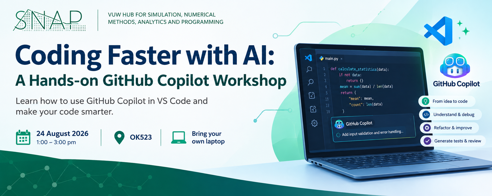
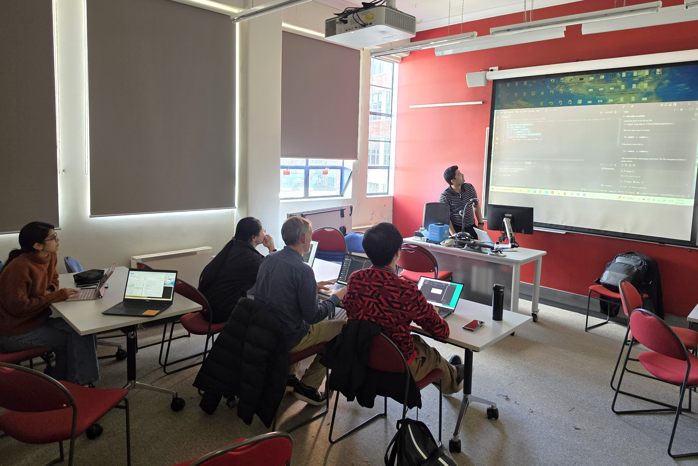

{height=250 fig-align="center"}

<h1>SNAP Workshop on Coding Faster with AI – A Hands-on GitHub Copilot Workshop</h1>

On 24 August 2026, SNAP hosted a hands-on workshop titled “Coding Faster with AI”, presented by Nabeel Aslam, a PhD student in the School of Engineering and Computer Science. The workshop introduced participants to practical ways to use GitHub Copilot with Visual Studio Code (VS Code) to make software development more efficient and productive.

The session demonstrated how AI-assisted coding can support researchers at different stages of software development. Participants explored how to translate ideas and requirements into code, use Copilot to understand existing code, and assist with debugging and refactoring. The workshop also covered generating tests, improving code, and using AI to review development work.

Rather than focusing solely on the theory behind AI-assisted programming, the workshop adopted a learn-by-doing approach, combining short demonstrations with hands-on challenges. Participants were able to experiment directly with GitHub Copilot in VS Code and see how AI tools can help make their code smarter while reducing some of the routine effort involved in programming.

The workshop provided an opportunity for students and researchers to explore how emerging AI coding tools can be integrated into their existing workflows to support more efficient software development.

The presentation of this workshop is available [here](Github_Copilot_Training.pdf).

{height=500 fig-align="center"}

